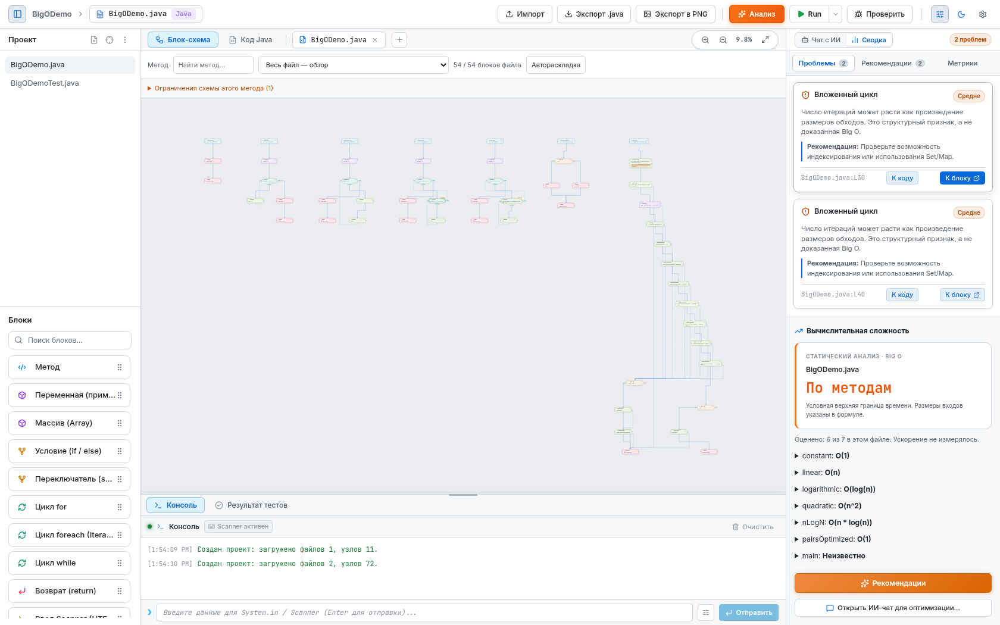
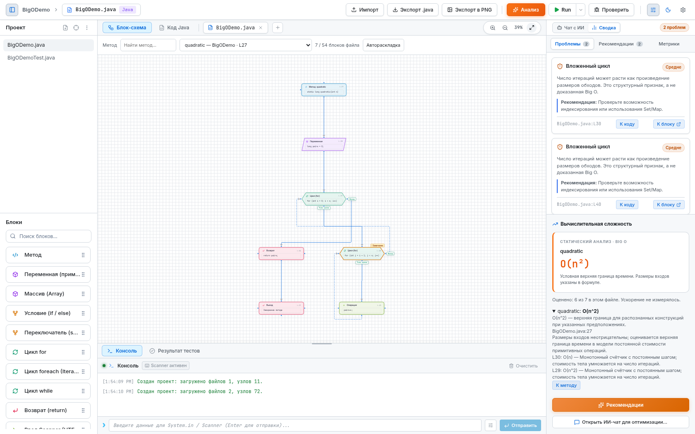
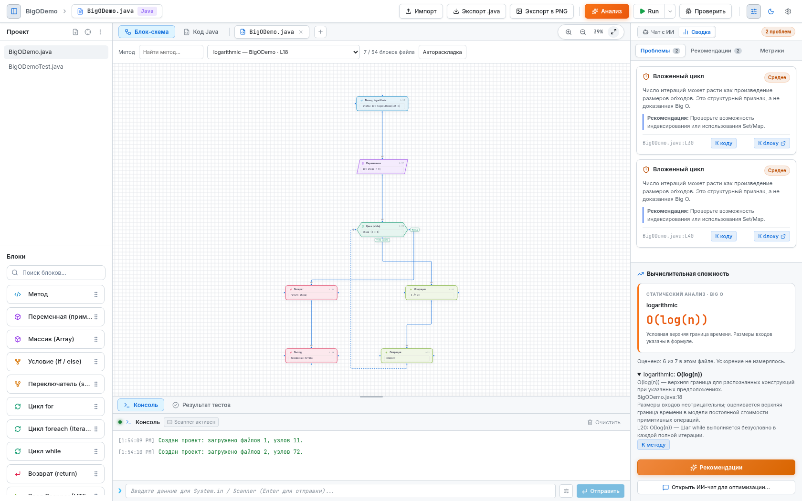
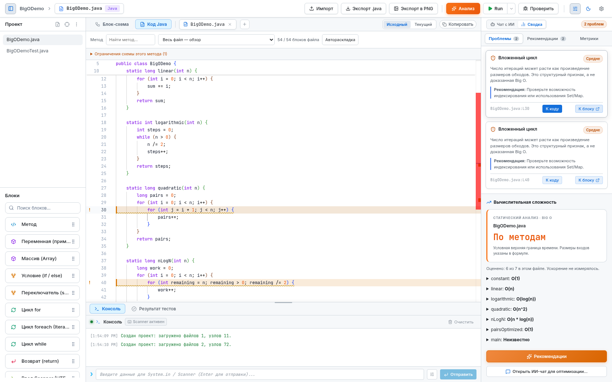
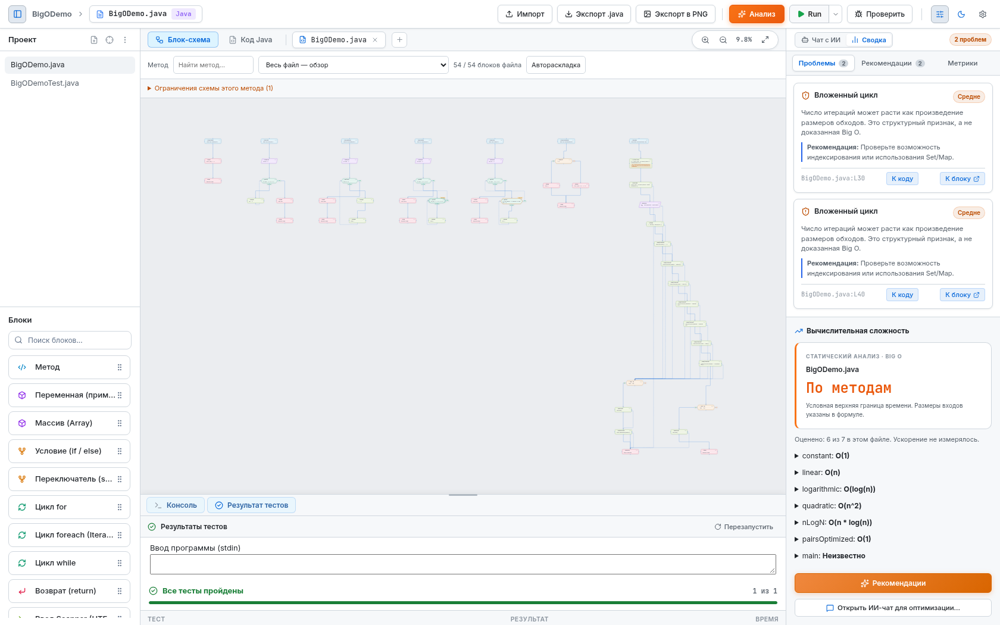
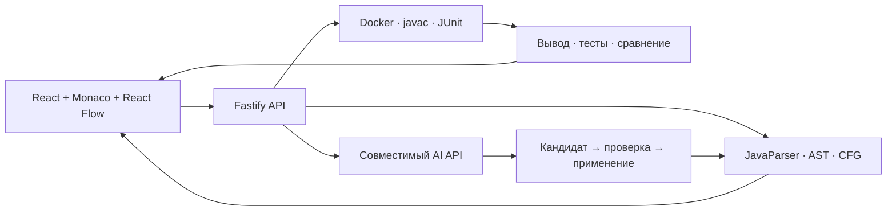

<div align="center">

# JavaScope

### Java-код ↔ блок-схема ↔ проверка поведения

Визуальная среда для исследования и изменения Java-монолитов.<br>
Проект по кейсу **Java Blueprints · AXENIX**.

[](https://javascope.193-233-246-241.sslip.io/)
[](backend/README.md)
[](backend/README.md)
[](https://github.com/vrpottot/JavaBlueprint/actions/workflows/check.yml)

[Демонстрация](https://javascope.193-233-246-241.sslip.io/) · [Запуск локально](#запуск-локально) · [Скриншоты](#big-o-в-приложении) · [Проверки](#как-мы-проверяем-результат) · [Ограничения](#границы-анализа)

</div>



## Что делает JavaScope

Загрузите `.java` и тесты, выберите метод, исследуйте его схему и внесите правку в блоке или редакторе. JavaScope изменяет настоящий исходник через AST, компилирует его и запускает JUnit в Docker. Затем сравнивает stdout, stderr и код завершения с исходной версией на одинаковом вводе.

| Возможность | Что получает пользователь |
| --- | --- |
| Java → граф | Методы, конструкторы, условия, switch, циклы, операции, возвраты и маршруты исключений |
| Граф → Java | Изменения условий и инструкций, добавление/копирование/удаление блоков и методов |
| Два редактора | Изменения кода отражаются на схеме; блок открывает соответствующую строку Java |
| Диагностика | Подсвеченные узлы и строки, уровень замечания, объяснение и рекомендация |
| Big O | Условная верхняя граница выбранного метода, предположения и привязанные к строкам правила |
| Проверка | Реальные javac и JUnit 5, несколько входов и сравнение с оригиналом |
| ИИ | Анализ и предложения через серверный API; кандидат проходит проверку перед применением |
| Экспорт | Текущий `.java` и PNG видимой схемы |

## Попробовать за две минуты

**Демо: [javascope.193-233-246-241.sslip.io](https://javascope.193-233-246-241.sslip.io/)**

1. Скачайте [BigODemo.java](backend/examples/BigODemo.java) и [BigODemoTest.java](backend/examples/BigODemoTest.java).
2. Нажмите **«Импорт»**, снимите **«Добавить к текущему проекту»**, выберите сразу оба файла. При выборе одного файла подтвердите импорт кнопкой в форме.
3. В **«Метод схемы»** выберите `quadratic`: справа появится **O(n²)**, вложенный цикл будет отмечен на графе. В карточке замечания доступны **«К блоку»** и **«К коду»**.
4. Выберите `pairsOptimized`: оценка станет **O(1)**. Это альтернативный подсчёт числа пар, а не автоматически применённая оптимизация.
5. Откройте **«Результат тестов»**, задайте ввод `16`, нажмите **Run**. После запуска снова откройте вкладку тестов: ожидаются **JUnit 5 (3 tests found)** и совпадение поведения на проверенном вводе.

Тест отдельно сравнивает обе реализации подсчёта пар на граничных и обычных значениях. Для проверки сохранения поведения при собственной правке измените блок, затем запустите Run ещё раз.

## Big O в приложении

Все изображения ниже сняты с работающего приложения. Формулы проверяются через API перед сохранением скриншота; соответствующий Java-код компилируется и проходит настоящий JUnit.

| Квадратичный обход | Логарифмическое число шагов |
| --- | --- |
|  |  |

| Подсветка в Java-редакторе | Проверка Java и JUnit |
| --- | --- |
|  |  |

**[Скачать 9 скриншотов для презентации одним ZIP](docs/screenshots/presentation-screenshots.zip)** · [Галерея и пояснения](docs/screenshots/README.md).

Отдельные PNG: [O(1)](docs/screenshots/big-o-constant.png), [O(n)](docs/screenshots/big-o-linear.png), [O(log n)](docs/screenshots/big-o-logarithmic.png), [O(n log n)](docs/screenshots/big-o-n-log-n.png), [O(n²)](docs/screenshots/big-o-quadratic.png), [вариант O(1)](docs/screenshots/big-o-optimized.png). [Исходные данные проверок](docs/screenshots/evidence.json).

Подсветка использует и цвет, и текст: оранжевый — замечание, красный — высокий риск, синий — рекомендация. Наведение показывает объяснение. Наличие вложенного цикла — повод проверить алгоритм; оно само по себе не доказывает дефект. Нераспознанная стоимость обозначается `unknown` с причиной.

## Запуск локально

Нужны **Node.js 22.12+**, **JDK 21** и **Docker Engine / Docker Desktop**. Команды `node`, `npm`, `java`, `javac` и `docker` должны быть доступны в терминале. Docker должен быть запущен и поддерживать ограничения памяти, CPU и числа процессов. Интернет нужен для первой установки npm-пакетов, JavaParser/JUnit и Docker-образа.

```bash
git clone https://github.com/vrpottot/JavaBlueprint.git
cd JavaBlueprint

# Установить backend и собрать JavaParser CLI
npm --prefix backend ci
npm --prefix backend run setup

# Собрать изолированный образ javac/JUnit
npm --prefix backend run runner:build

# Создать локальную конфигурацию
cp backend/.env.example backend/.env

# Установить frontend
npm --prefix frontend ci
```

**Терминал 1 — backend:**

```bash
cd backend
npm run dev
```

**Терминал 2 — frontend, из корня репозитория:**

```bash
npm --prefix frontend run dev
```

Откройте **[http://localhost:5173](http://localhost:5173)**. Backend слушает `127.0.0.1:3001`, Vite перенаправляет туда `/api`. Проверка доступности: **[http://127.0.0.1:3001/api/health](http://127.0.0.1:3001/api/health)**.

<details>
<summary><strong>Если что-то не запускается</strong></summary>

| Симптом | Что проверить |
| --- | --- |
| `java` / `javac` не найдены | Установлен JDK 21, его `bin` находится в PATH |
| Ошибка сборки Java engine | Повторить `npm --prefix backend run setup` из корня |
| `RUNNER_UNAVAILABLE` | Запустить Docker; `docker info` должен завершаться успешно |
| `RUNNER_IMAGE_MISSING` | Выполнить `npm --prefix backend run runner:build` |
| `RUNNER_LIMITS_UNAVAILABLE` | Включить Docker/cgroups с поддержкой лимитов CPU, памяти и PID |
| API недоступен во frontend | Проверить, что backend запущен на порту 3001 |
| Нет ответа ИИ | Для локального ИИ нужен доступный совместимый API и переменные ниже; граф, анализ, javac и JUnit работают без него |
| После перезапуска исчез проект | Проекты хранятся в памяти; повторно импортировать исходники |

В PowerShell вместо `cp backend/.env.example backend/.env` можно использовать `Copy-Item backend/.env.example backend/.env`.

</details>

<details>
<summary><strong>Необязательная настройка ИИ</strong></summary>

В `backend/.env` задайте:

```dotenv
AI_API_KEY=your-provider-key
AI_BASE_URL=https://your-provider.example/v1
AI_MODEL=your-model
```

Это шаблон: замените адрес и модель данными своего провайдера. Ключ хранится только на сервере и не должен попадать в Git или переменные `VITE_*`. Адрес `127.0.0.1` подходит только для реально запущенного локального gateway. [Контракт и проверка предложений ИИ](backend/AI_CONTRACT.md).

</details>

## Как устроен проект



| Папка | Содержимое |
| --- | --- |
| `frontend/` | React 19, TypeScript, Monaco, React Flow, темы и интерфейс |
| `backend/src/` | Fastify API, проекты, анализ, Docker runner и AI gateway |
| `backend/java-engine/` | JavaParser CLI: разбор, AST-правки, граф потока и модель стоимости |
| `backend/examples/` | Небольшие демонстрации, большие монолиты и JUnit-тесты |
| `backend/tests/` | API, сложность, AST-правки, deployment gate и Playwright |
| `deploy/` | HTTPS, systemd и публикация проверенных релизов на VPS |
| `docs/` | Скриншоты, аудиты, воспроизводимые ошибки и результаты |

Обрабатываемый Java-код запускается только в Docker: без сети, с read-only окружением и лимитами CPU, памяти, PID и вывода. Доверенный JavaParser CLI разбирает код как данные и не загружает пользовательские классы на хосте.

## Как мы проверяем результат

**Короткие проверки:**

```bash
npm --prefix backend run typecheck
npm --prefix backend run test:ci
npm --prefix backend run test:frontend
npm --prefix frontend run lint
npm --prefix frontend run build
```

**Полный путь в браузере** — при запущенных frontend, backend и Docker:

```bash
# Один раз установить браузер Playwright
cd backend
npx playwright install chromium
npm run test:browser
```

Крупные программы и измерение покрытия запускаются вручную, чтобы CI не превращался в долгий стресс-тест. Три независимых монолита содержат **3 024 строки основного Java-кода**, **229 методов/конструкторов** и **45 JUnit-тестов** с независимыми алгоритмическими оракулами. [Монолиты и инструкция](backend/examples/jury/README.md) · [Аудит жюри](docs/audits/jury-2026-10-25/README.md).

Снимки для презентации можно воспроизвести: `npm --prefix backend run screenshots`. По умолчанию нужен локальный сервер; `-- --url URL` позволяет снять опубликованную версию. Скрипт проверяет формулы, компиляцию, JUnit и результат сравнения.

## Границы анализа

- Big O — условная верхняя граница для поддержанных конструкций. Условия, размеры данных и неизвестные вызовы перечислены рядом с оценкой. Универсальная точная оценка произвольного Java-кода не заявляется.
- Граф учитывает `finally`, отложенные выходы и закрытие ресурсов. Неизвестные типы исключений могут порождать консервативные ветки. Внутренний поток лямбд и switch-выражений пока не развёрнут полностью.
- Конструкторы импортируются и сохраняются; добавление конструктора выполняется через Java-код. Панель «Метод» создаёт методы.
- Совпадение тестов и вывода на выбранных входах подтверждает наблюдаемое поведение этих прогонов. Оно не доказывает эквивалентность на всех возможных входах.
- Проекты находятся в памяти. Это демонстрационная среда без постоянного хранилища и пользовательских аккаунтов.

Предыдущая оценка **70/100** относится к зафиксированной версии аудита. Что уже исправлено и какие результаты нужны для более высокой оценки: [план качества до защиты](docs/QUALITY_ROADMAP.md).

## Публикация

Фронтенд и API работают по HTTPS на VPS. Push в `main` запускает проверки GitHub Actions; только затем релиз отправляется на сервер, повторно проверяется и включается атомарно. [Workflow](.github/workflows/check.yml) · [Подробности деплоя](deploy/README.md) · [Backend API](backend/README.md).

**[Открыть JavaScope →](https://javascope.193-233-246-241.sslip.io/)**
